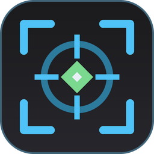

# ShapeAnchor — 几何特征匹配引擎（C# 从零实现）

> PatMax® 是 Cognex Corporation 的注册商标。本项目与其无任何隶属、授权或背书关系，仅在技术对照中指名提及。
> 名称 ShapeAnchor 为本项目自有名称，与上述商标无关。

在训练图上框一个区域，在任意搜索图中定位该目标，输出亚像素位置、角度、尺度；独立实现，不链接也不调用 `cogxpma.dll` / `Cognex.VisionPro.PMAlign.dll`。
合成真值 10/10 用例 PASS：位置误差 ≤ 0.10 px、角度误差 ≤ 0.12°、尺度误差 ≤ 0.0017。
640×480 单次完整搜索（含金字塔构建 + ±180° 全角度 + 亚像素拟合）14.21 ms = 21.6 Mpx/s；边缘前端 SIMD 并行 2.37 ms = 129.5 Mpx/s。

---

## 1. 定位

| 项 | 内容 |
|---|---|
| 做什么 | 训练图上一个区域 → 任意搜索图中定位该目标，输出亚像素位置 (x, y)、角度 θ、均匀尺度 s |
| 对标对象 | Cognex PatMax（运行时 API 名 PMAlign） |
| 实现方式 | 纯 C# 独立实现；不链接、不 P/Invoke、不加载 Cognex 的任何源码或二进制 |
| 交付形态 | 核心库 + 无头 CLI（演示 / 自测门禁 / 性能 / 真图验证）+ WPF 前端 |
| 运行环境 | .NET 8（`net8.0`）；核心库跨平台，WPF 前端仅 Windows |

“对标”的含义是：用同一套输入输出契约与参数语义（区域训练、位姿输出、评分阈值、重叠抑制）复现同类功能与同级精度，而不是对原版二进制的封装或转录。评分公式是对 PatMax 行为特征的工程复现，第 10 节说明哪些结论有硬证据、哪些没有。

## 2. 当前状态

| 项 | 状态 |
|---|---|
| 代码 | 已完成，精度与性能均实测（第 6、7 节） |
| 精度门禁 | `--selftest` 10 项用例全部 PASS，失败时进程退出码为 1，可直接接 CI |
| 真图验证 | 本机 12 张 640×480 标定图全部命中，score 全为 1.000（第 8 节） |
| CI | `.github/workflows/ci.yml`：ubuntu + windows 双平台构建核心库并跑 `--selftest`，Windows 额外构建 WPF |
| 未实现 | 透视（PatMaxPerspective）、PatFlex 形变匹配闭环、彩色/多光谱、非线性光照模型（第 13 节） |

## 3. 关键指标

| 指标 | 实测值 | 出处 |
|---|---|---|
| 位置误差（合成真值） | 0.012 – 0.098 px（遮挡 22% 时 0.026 px） | 第 6 节 |
| 角度误差（合成真值） | 0.043° – 0.112° | 第 6 节 |
| 尺度误差 | 0.0006 – 0.0017 | 第 6 节 |
| 误报 | 空场景 0 个接受结果；相似圆盘 0 个接受结果 | 第 6 节 |
| 单次搜索耗时 | 256×256 11.04 ms / 640×480 14.21 ms / 1280×960 24.69 ms | 第 7 节 |
| 搜索吞吐 | 5.9 / 21.6 / 49.8 Mpx/s | 第 7 节 |
| 边缘前端吞吐（640×480） | 标量串行 21.1 / SIMD 串行 72.2 / SIMD 并行 129.5 Mpx/s | 第 7 节 |
| 训练特征数 | 典型 143（真图标定件包围盒）/ 上限 600 | 第 8、9 节 |
| 真图命中率 | 12/12 张，单帧 7–13 ms | 第 8 节 |

## 4. Review 结论：上一版为何推倒重写

上一版能编译、能出结果，但“算法没有真正工作”。以下 8 个问题在重写前逐条复现确认，本版逐条对应修正，是本仓库当前设计的直接来源。

| # | 上一版问题 | 后果 | 本版做法 |
|---|---|---|---|
| 1 | 12 个朝向在 `Parallel.For` 里共用同一个 `response` 缓冲 | 数据竞争，同一输入多次运行结果不一致 | 取消“12 朝向并行累加”这一结构：特征存有符号方向导数场，任意方向的响应是一次点乘，不存在线程间共享写缓冲 |
| 2 | Gabor 核用余弦相位（偶对称） | 响应对亮线而非阶跃边最大，且不携带极性 | 主路径换成可分离 DoG 梯度场（奇对称，对阶跃边响应最大），特征显式携带极性；Gabor 保留为保真对照路径 |
| 3 | 模板 = 整幅训练图做滑窗 | 滑窗只有一个合法位置，匹配结果**恒等于训练原点**；平移/旋转/遮挡测试全部返回同一坐标 | 模板改为稀疏特征集（位置、单位法线、极性、强度），在搜索图金字塔上做方向敏感相关，峰值可落在任意位置 |
| 4 | 位姿拟合的源点与目标点是同一批预测点 | 拟合恒为单位变换，位姿小数位毫无意义 | 对应点来自沿特征法线**实测**的亚像素边缘位置，与预测点分离；再做稳健相似变换最小二乘 |
| 5 | `magnitude > 0` 即算命中 | 噪声与纹理也计分，误报严重（空场景曾报出 5 个目标） | 三重门：`score = coverage^(1/N)` 与 `AcceptThreshold` 比较、`ContrastThreshold` 对比度门限、粗层 `CoarseAcceptThreshold` 预筛，外加 clutter 惩罚 |
| 6 | `BuildChains` 最近邻增长 O(n²) | 数千边缘点即不可用 | 空间哈希 + BFS 洪泛（`ShapeAnchorTool.BuildChains`），近线性 |
| 7 | UI 的 `ScaleMin/Max` 从未传给算法 | 尺度搜索形同虚设 | `BuildOptions` 把每个公开参数逐项映射进 `SearchOptions`，含尺度区间 |
| 8 | 没有任何测试或基准，README 里的性能数字不可复现 | 改动的方向无从判断 | 新增 `Benchmarks`（合成真值渲染、精度与性能套件、真图验证）、`--selftest` 门禁退出码、双平台 CI |

## 5. 算法

### 5.1 训练

1. 灰度化，构造**可分离 DoG 梯度场** (Gx, Gy)：σx = 2.0506096654409878、核半径 7（半窗），σy = 4.1012193308819755 = 2 × σx（`SensitivityParameter = 2.0`）。
2. 沿**梯度方向**做脊线细化（ridge thinning），把梯度带压到单像素宽。
3. 按幅值排序。
4. **泊松盘采样**保证特征在空间上铺开，而不是全挤在最强的一小片。
5. 输出特征集 `{位置, 单位法线, 极性, 强度}`，外加 `W` / `N` / 对比度基准三个归一化量。

### 5.2 搜索

1. 搜索图建**边缘金字塔**。
2. 最粗层对 **(角度 × 尺度)** 穷举，用少量特征（`CoarseFeatureCount`）做方向/极性敏感的相关，得到候选假设。
3. 逐层细化：位置窗 → 角度窗（含抛物线插值）→ 位置窗，特征数逐层增长（`MidFeatureCount` → 全特征）。
4. 全特征评分 `score = coverage^(1/N)`，含干扰惩罚（clutter）与对比度门限。
5. 每个特征沿**自身法线**在搜索图上找真实边缘，得到亚像素位置。
6. 稳健 2D 相似变换最小二乘拟合，输出位姿。

关键点：第 5 步的对应点来自**实测边缘位置**，不是把预测点拟合到自身——这正是上一版第 4 条问题的反面。

### 5.3 评分与接受判据

`MatchResult` 暴露三段可解释分量：

| 字段 | 含义 | 范围 |
|---|---|---|
| `Score` | PatMax 风格得分，`coverage^(1/N)` 加权 | 0–1 |
| `Coverage` | 命中特征占全模型的比例 | 0–1 |
| `Clutter` | 未找到边缘的特征比例代理量（`0.5 × 未匹配/总数`），用于把未被模型解释的影像压低分数；与原版 clutter 的定义不同，见 `MatchResult.Clutter` 注释 | 0 = 干净，1 = 全干扰 |
| `FitError` | 位姿拟合的 RMS 残差 | 像素 |

接受判据：`Accepted ⟺ Score ≥ AcceptThreshold`。半遮挡件得分约 0.7 而不是坍塌到 0，正是 `coverage^(1/N)` 这个指数分母的作用（实测：遮挡 22% → score 0.831）。

### 5.4 为什么不量化到 12 个朝向

特征存的是**有符号方向导数场**，而不是量化到 12 个朝向的索引。因此任意方向的响应只需一次点乘：角度连续，没有量化台阶，亚像素位姿拟合才有意义。上一版的 12 朝向量化既引入了 15°（360°/24）级的角度台阶，又要求共享缓冲并行累加，是问题 1 与问题 4 的共同根源。

## 6. 精度实测

环境：合成齿轮件，真值由渲染位姿精确给定；`dotnet run -c Release -- --selftest`；i9-12950HX / 24 线程；**第一行含 JIT 冷启动**。

| 用例 | score | 位置误差 | 角度误差 | 尺度误差 | 耗时 |
|---|---|---|---|---|---|
| 平移（亚像素） | 1.000 | 0.026 px | 0.054° | 0.0009 | 32.9 ms |
| 旋转 17.5° | 1.000 | 0.027 px | 0.043° | 0.0009 | 16.4 ms |
| 旋转 −63° | 1.000 | 0.016 px | 0.056° | 0.0008 | 12.7 ms |
| 尺度 1.12 | 1.000 | 0.040 px | 0.061° | 0.0008 | 15.8 ms |
| 高斯噪声 σ=20 | 1.000 | 0.098 px | 0.068° | 0.0006 | 10.4 ms |
| 遮挡 22% | 0.831 | 0.026 px | 0.112° | 0.0017 | 11.5 ms |
| 干扰物 ×6 | 1.000 | 0.012 px | 0.063° | 0.0008 | 10.4 ms |
| 多目标 3 实例 | — | 0.028 px | 0.046° | — | 16.2 ms |
| 空场景（不得误报） | 0 个接受结果 | — | — | — | 6.0 ms |
| 相似圆盘（不得误报） | 0 个接受结果 | — | — | — | 9.4 ms |

10 项用例全部 PASS。`--selftest` 在失败时以退出码 1 结束，因此这一节本身就是可自动化的验收条件，而不是文档里的宣称。

## 7. 性能实测

完整单次搜索，含金字塔构建 + ±180° 全角度搜索 + 亚像素拟合，单目标：

| 图像 | 耗时 | 吞吐 |
|---|---|---|
| 256×256 | 11.04 ms | 5.9 Mpx/s |
| 640×480 | 14.21 ms | 21.6 Mpx/s |
| 1280×960 | 24.69 ms | 49.8 Mpx/s |

边缘前端（640×480）：

| 模式 | 耗时 | 吞吐 |
|---|---|---|
| 标量串行 | 14.56 ms | 21.1 Mpx/s |
| SIMD 串行 | 4.26 ms | 72.2 Mpx/s |
| **SIMD 并行（默认）** | **2.37 ms** | **129.5 Mpx/s** |
| Gabor 12 朝向 SIMD 并行（保真路径） | 24.21 ms | 12.7 Mpx/s |

大图吞吐反而更高，是因为单次搜索的固定开销（金字塔构建、候选扫描、拟合）在小图上占比更大；绝对耗时随面积亚线性增长是正常表现，不是测量错误。
表中数值为同一台机器（i9-12950HX / 24 线程、.NET 8 Release）单次运行的代表值，重复运行波动约 ±15%，其中 1280×960 的绝对波动最大。

## 8. 真图验证

### 8.1 标定网格集（`D:\FTP\calibration`，12 张 640×480 PNG）

9 张 3×3 平移网格 + 3 张旋转件。

| 项 | 结果 |
|---|---|
| 训练 | 在 `1.png` 上按内容包围盒训练，143 个特征 |
| 命中 | 12/12 全部命中，11 张 score = 1.000 |
| 原点分布 | x ≈ 64.5 / 318.7 / 573.1，y ≈ 60.5 / 240.0 / 419.4，构成 3×3 网格 |
| 与 `points.txt` 一致性 | 与标定文件的 170 / 120 像素网格间距一致 |
| 耗时 | 单帧 8–15 ms |
| 旋转件 | 相对基准件测得 +60.05° / −59.93° |
| 唯一弱项 | `7.png`：零件被画幅上边缘截断，覆盖率 59%、score 0.687、位置偏 2.7 px —— 截断件的位姿必然有偏，属可解释结果 |

旋转件的读数需要解释：该零件在 60° 间隔下自相似，因此 +60.05° / −59.93° 是 ±120° 真值的**对称等价解**，不是误差。算法给出的是搜索空间内与观测最一致的那个等价位姿——这说明搜索行为正确，也说明自相似工件上"唯一角度"本身不是良定义的。

### 8.2 车间实拍集（`D:\FTP\patmax`，17 张 640×480 BMP）

这批是真实工况的混合挑战集：多种位姿、极端曝光（均值 9–219）、塑料袋覆层、强干扰背景、多零件同框。**没有真值**，因此报告按置信度分档，而不是宣称全部正确：

| score 档 | 张数 | 说明 |
|---|---|---|
| ≥ 0.90 | 8 | 覆盖率 ≥ 95%，位姿可信 |
| 0.70–0.90 | 2 | 部分遮挡/覆层，位姿可信度稍低 |
| < 0.70 | 7 | **结果不可用**，逐张原因见下 |

低于 0.70 的 7 张，逐张原因（都已肉眼核对图像）：

| 图像 | 现象 | 原因 |
|---|---|---|
| `3.bmp` | 均值 16，近乎全黑 | 对比度低于噪声级，边缘场接近空 |
| `7.bmp` | 背景过曝成白 | **对比度极性反转**（暗零件/亮背景），模型是有极性的；需训练时置 `IgnorePolarity` |
| `14.bmp` / `15.bmp` | 强结构干扰背景（印刷品/机械照片） | 干扰边缘密度远高于零件 |
| `17.bmp` | 同框多个零件且互相遮挡 | 单目标假设 + 只取 1 个结果 |
| `4.bmp` / `12.bmp` | 部分遮挡/景深模糊 | 覆盖率 47% / 68% |

结论：在曝光正常、背景干净、单目标的真实图上行为正确（8.1 节 12/12）；上面 7 张是**已知边界**，不是随机失败。`--cal` 会把每张的 score、位姿、覆盖率、耗时和 score 分档一并打印出来，不隐藏弱项。

命令：`dotnet run -c Release -- --cal <目录> [--ncc] [--no-autofloor]`。
目录内支持 `.png` 与 `.bmp`，按文件签名判断格式；文件名按自然序（`2` 在 `10` 之前）排序，第一张作为训练基准。

## 9. 参数

### 9.1 参数速查表（本实现默认值）

| 参数 | 默认值 | 作用 |
|---|---|---|
| `AcceptThreshold` | 0.70 | 输出为接受结果的最低 `Score` |
| `CoarseAcceptThreshold` | 0.33 | 粗层预筛门限，低于此值不再进入细化 |
| `ContrastThreshold` | 0.08 | 归一化对比度门限：与该层边缘幅值的 80 分位之比，低于它的响应不算命中 |
| `ScoreExponentN` | 2.0 | 评分指数分母：`score = coverage^(1/N)` |
| `RotationAngleMin` / `RotationAngleMax` | −180 / +180 | 角度搜索区间（度） |
| `ScaleMin` / `ScaleMax` | 1.0 / 1.0 | 尺度搜索区间（相等 = 不做尺度搜索） |
| `PrecisionStep` | 2 | 粗层位置步长（1 = 更彻底，4 = 更快） |
| `CoarseFeatureCount` | 32 | 穷举相关阶段使用的特征数 |
| `MidFeatureCount` | 96 | 中间细化阶段使用的特征数 |
| `MaxCandidates` | 20 | 从粗层带入细化的假设数 |
| `CoarseAngleStepDeg` | 15 | 穷举阶段的角度步长（度） |
| `SubpixelRefinement` | true | 亚像素边缘法向细化 + 最小二乘位姿拟合 |
| `NormalSearchRadius` | 1.5 | 沿法线搜索真实边缘的半径（像素） |
| `NormalSearchStep` | 0.5 | 沿法线搜索的步长（像素） |
| `PoseFitMaxPoints` | 120 | 位姿拟合使用的最大对应点数 |
| `ClusterRadius` | 8 | 两个实例的最小间距（像素），更近则合并 |
| `TrainMaxFeatures` | 600 | 训练特征数上限 |
| `TrainMinSpacing` | 2.0 | 泊松盘采样的最小间距（像素） |
| `IgnorePolarity` | false | 训练时忽略边缘极性 |
| `NoiseFloor` | 8.0 | 低于此梯度幅值不视为边缘（对应原版 `EdgeThreshold`） |
| `AutoNoiseFloor` | true | 自动边缘阈值：门限在 `max(3×中位数, 10%×p99)` 与 `NoiseFloor` 之间取小值，仅在"最强边缘也很弱"的欠曝帧才下调 |
| `NormalizedCorrelation` | false | 粗层归一化相关（增益无关）。实测为平手：修好暗帧、弄坏塑料袋覆层件，故默认关闭 |
| `IgnorePolarity` | false | 无极性匹配（比较 \|方向导数\|）。反光/剪影场景需要；代价是区分力下降 |

### 9.2 与 Cognex 原版对应

原版默认值读自本机安装的 `Cognex.VisionPro.PMAlign.dll` 的 ECMA-335 元数据与 `[DefaultValue]` 属性，取证记录见 `docs/evidence/params-reference.md`。

| 本实现 | 原版（`Cognex.VisionPro.PMAlign`） | 关系 |
|---|---|---|
| `AcceptThreshold` 0.5 | `AcceptThreshold` 0.5 | 一致 |
| `CoarseAcceptThreshold` 0.33 | `CoarseAcceptThreshold` 0.33 | 一致 |
| `ContrastThreshold` 0.08 | `ContrastThreshold` 10（0–65535 单位） | 本实现改为按该层幅值基准归一化的 0–1 比值 |
| `NoiseFloor` 8.0 | `EdgeThreshold` 训练 10.0 / 运行 5.0 | 训练/运行门限合并为单一噪声门限 |
| `MaxLevels` + `Grain` | `GrainLimitFine` 1 / `GrainLimitCoarse` 4 | 金字塔层数 + grain 参数的等价表达 |
| `UseClutter` true | `ScoreUsingClutter` true | 一致 |
| `ClusterRadius` 8 px | `XYOverlap` 0.8 | 重叠抑制改按像素间距表达 |
| `Run(image, maxResults)` | `ApproximateNumberToFind` 1 | 改为调用参数，不设属性 |
| `IgnorePolarity` false | `IgnorePolarity` false | 一致 |
| `TimeoutMs`（0 = 不限） | `Timeout` 5000 / `TimeoutEnabled` false | 语义一致，默认不限时 |
| 未接入（只实现 PatMax 路径） | `TrainAlgorithm` 2 = `PatMaxAndPatQuick`、`RunAlgorithm` 2 = `BestTrained` | 已建同名枚举 `TrainAlgorithmConstants` / `RunAlgorithmConstants` |

### 9.3 参数预设（实测）

预设目录放在库里（`Core/SearchPreset.cs`），UI 的下拉框与命令行走的是同一份数据，所以下面每个数字都可以用
`dotnet run -c Release -- --presets <目录>` 复现。

| 预设 | 用途 | 关键差异 |
|---|---|---|
| 通用（默认） | 绝大多数场景的起点 | 360° 搜索、不做尺度、阈值 0.70、杂波计分 |
| 小角度快搜 | 夹具已定向，只查 ±10° | 角度空间最小，最快；超出窗口的件按设计判为无结果 |
| 高精度（慢） | 计量级读数 | 粗层步长 1、特征 1200、间距 1.5 px、阈值 0.75、角度 ±30、尺度 0.95–1.05 |
| 大角度 + 尺度 | 任意姿态且存在尺寸差 | ±180°、尺度 0.9–1.1 |
| 反光 / 剪影 | 极性反转（背光、镜面） | `IgnorePolarity`，阈值抬到 0.80（0.65 会放过高分错误位姿，见下） |
| 暗场 / 低对比 | 欠曝 | 自动边缘阈值、门限 4、阈值 0.60 |
| 多目标 | 一图多件 | 预期 5 件、最多 20 个结果、XY 重叠 0.3、阈值 0.60 |

`D:\FTP\calibration`（12 张标准件，全部应在 ≥0.9）实测：

| 预设 | 命中 | ≥0.90 |
|---|---|---|
| 通用（默认） | 11/12 | 11 |
| 小角度快搜 | 10/12（按设计拒掉 ±60° 的 2 张） | 10 |
| 高精度（慢） | 10/12（同上） | 10 |
| 大角度 + 尺度 | 12/12 | 12 |
| 反光 / 剪影 | 12/12 | 12 |
| 暗场 / 低对比 | 12/12 | 11 |
| 多目标 | 12/12 | 11 |

`D:\FTP\patmax`（17 张实拍挑战集，含暗场、背光、塑料袋、结构化杂波、多件）实测：

| 预设 | 命中 | 均分 | 最多实例 |
|---|---|---|---|
| 通用（默认） | 10/17 | 0.961 | 1 |
| 小角度快搜 | 9/17 | 0.979 | 1 |
| 高精度（慢） | 6/17 | 0.959 | 1 |
| 大角度 + 尺度 | 11/17 | 0.947 | 1 |
| 反光 / 剪影 | 12/17 | 0.939 | 4 |
| 暗场 / 低对比 | 13/17 | 0.884 | 2 |
| 多目标 | 11/17 | 0.932 | 2 |

结论与取舍：

- 默认组在这两套数据上都稳定：标准件 11/12，挑战集 10/17（其余 7 张是暗到无边缘、或零件被遮挡/出框的帧）。
- **小角度快搜确实会拒绝窗口外的帧**，这是设计行为，不是漏检：校准集里 ±60° 的 2 张、挑战集里 −36°/−32° 的帧都被拒。
  这条曾经是 bug（细化阶段会把角度走出窗口），已在 `SearchEngine.InAngleWindow` 修复。
- **反光/剪影的阈值不能低**：0.65 时会接受 79°、159° 这类明显错误的位姿，抬到 0.80 后反而从 16/17 降到 12/17——
  宁可少给，不给错。
- 多目标预设的实例数上限取决于件之间的实际遮挡；挑战集里最多 4 个实例，互不遮挡的托盘图能到更多。

## 10. 二进制取证与边界

`docs/evidence/api-surface.md`、`docs/evidence/params-reference.md`、`docs/evidence/native-strings.md` 是对本机安装的 Cognex 二进制做的**静态取证**：读元数据表、常量表与属性 blob，全程未运行 VisionPro。

| 结论 | 等级 | 依据 |
|---|---|---|
| 边缘前处理默认参数块 `{20.0, 1.0, σx=2.0506096654409878, σy=4.1012193308819755, 核半窗 7, 相位 1}` | 硬证据 | 出现在托管程序集的混合模式原生 `.text` 中，函数起始 RVA `0x00EAF2C0` / 文件偏移 `0x00EAE8C0` |
| `4.1012… = 2 × 2.0506…` 精确 2 倍 | 硬证据 | 同上常量表；与本实现 `SensitivityParameter = 2.0` 吻合 |
| 原版参数默认值与枚举值（第 9.2 节右列） | 硬证据 | ECMA-335 元数据表 + `[DefaultValue]` 属性 blob |
| 评分 = `Score` + `Coverage` + `Clutter` + `FitError` 三段可解释分量 | 硬证据（API 面） | 托管 API 的属性/字段面；本实现 `MatchResult` 暴露了这四个量 |
| 评分公式的解析形式与权重 | **工程复现，非反汇编结论** | 见下 |

与本机 VisionPro QuickBuild 里运行的 `PatMax_Demo` 作业（`CogPMAlignTool1`）逐项对照过训练参数面板：该演示使用 **PatMax 与 PatQuick**、特征粒度自动选择（粗糙 6.15 / 精细 1）、**自动边缘阈值勾选且值 10**、**忽略极性勾选**。本实现对应的 `AutoNoiseFloor`（默认开）与 `IgnorePolarity`（默认关，可开）即按此对齐；`IgnorePolarity` 实测在该 17 张上会把判别力换出去（`2.bmp` 由 1.000 降到 0.674），因此默认不启用。

必须写明的一件事：原生核心 `cogxpma.dll` 是 WIBU 加壳的（18 个节中 17 个是 `__wibu*`，熵 7.99–8.00，没有 `.text` / `.rdata`）。因此任何来自该原生 dll 的 RVA、结构体偏移或指令级推导**静态不可复核**。本项目的评分公式是对 PatMax 行为（例如半遮挡仍约 0.7）的工程复现，不是从机器码里逐条读出的。第 10 节表格之外的数值关系，请按“行为对齐”而不是“逆向事实”来读。

## 11. 项目结构

```
ShapeAnchor/
├── Core/        GrayImage, RectI, PngReader, PatternModel, PatternMulti, Dipole
├── Edge/        GaborEdgeDetector（DoG 主路径 + Gabor 保真路径）
├── Matching/    SearchPyramid, SearchEngine, Scorer, PeakDetector, SearchOptions, MatchResult
├── Fit/         LeastSquaresFitter（刚体/相似/仿射 + 稳健重加权）
├── Training/    PatternTrainer（脊线细化 + 泊松盘特征选择）
├── Projection/  DiffOfGauss1D, ProjectionMethod
├── Transform/   XformTps（PatFlex 薄板样条）
├── Benchmarks/  SyntheticPart（可合成真值场景）, BenchmarkSuite（精度+性能）, CalibrationCheck（真图验证）
├── docs/evidence/  二进制取证
├── tools/cognex-meta/  元数据导出工具（可复现取证）
├── .github/workflows/ci.yml
├── Program.cs   CLI：演示 / --selftest / --bench / --cal <目录>
└── ShapeAnchor.UI/  WPF 前端
```

## 12. 快速开始

> 应用图标 `ShapeAnchor.UI/Assets/shapeanchor.ico`（16–256 多尺寸），生成脚本见 `docs/make_icon.py`。

```csharp
var tool = new ShapeAnchor.ShapeAnchorTool
{
    AcceptThreshold = 0.6,
    RotationAngleMin = -30, RotationAngleMax = 30
};
// 训练整图中的一个区域（原点默认取区域中心）
var pattern = tool.TrainRegion(image, new RectI(120, 90, 160, 140));
// 在另一张图上搜索，最多 5 个实例
foreach (var r in tool.Run(searchImage, 5))
    Console.WriteLine($"{r.Score:F3} ({r.X:F2},{r.Y:F2}) {r.Angle * 180 / Math.PI:F2}° x{r.Scale:F3}");
```

`MatchResult.Angle` 是弧度，打印时乘 `180 / Math.PI`。

命令行：

| 命令 | 作用 |
|---|---|
| `dotnet run -c Release` | 演示 + 核常数 + 精度套件 + 性能套件 |
| `dotnet run -c Release -- --selftest` | 精度门禁，全过退出码 0，任一失败退出码 1 |
| `dotnet run -c Release -- --bench` | 只跑性能 |
| `dotnet run -c Release -- --cal <目录> [--ncc] [--no-autofloor] [--ignore-polarity]` | 对目录内 PNG/BMP 做真图验证 |
| `dotnet run --project ShapeAnchor.UI -c Release` | WPF 前端 |

## 13. 覆盖范围

| 已覆盖（含实测） | 未覆盖 |
|---|---|
| 平移 | 透视（PatMaxPerspective） |
| 任意旋转（±180°） | PatFlex 形变匹配（`XformTps` 有独立实现，未接入搜索闭环） |
| 均匀尺度 | 彩色 / 多光谱 |
| 多目标（同图多实例） | 非线性光照模型 |
| 部分遮挡（22%） | 各向异性（非均匀）尺度 |
| 噪声（σ=20）、干扰物（×6） | 原版 `TrainAlgorithm` / `RunAlgorithm` 的非 PatMax 路径 |
| 多模型（`PatternMulti`） | |
| 亚像素位姿（位置/角度/尺度三量同时拟合） | |
| 真图（12 张 640×480 标定件） | |

## 14. 复现

哪条命令产出哪张表：

| 命令 | 产出 |
|---|---|
| `dotnet run -c Release -- --selftest` | 第 6 节精度表；退出码即 PASS/FAIL 结论 |
| `dotnet run -c Release -- --bench` | 第 7 节两张表（整帧搜索 + 边缘前端） |
| `dotnet run -c Release` | 同一套精度与性能表，外加 DoG 核常数、1D 卷积脉冲响应、仿射拟合与 TPS 演示 |
| `dotnet run -c Release -- --cal <目录>` | 第 8 节真图验证（命中数、score、原点网格、单帧耗时） |
| `dotnet run --project ShapeAnchor.UI -c Release` | WPF 前端（训练区域、参数面板、搜索与结果叠加） |
| `.github/workflows/ci.yml` | ubuntu + windows 构建核心库并跑 `--selftest`；Windows 额外构建 WPF |

第 7 节的数字与本机 CPU / 线程数相关（i9-12950HX / 24 线程）；第 6 节的精度数字与机器无关，换机器跑出的误差应当处于同一量级。

## 15. 许可

MIT，仅供学习与研究。

- 本项目是独立实现，不包含 Cognex 的源码或二进制。
- PatMax、PMAlign、Cognex、VisionPro 为其各自所有者的商标，此处的使用仅用于说明对标目标。
