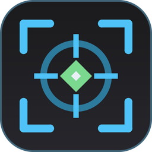

# ShapeAnchor — a geometric feature matcher written from scratch in C#

Train one region of a training image, then locate that target in any search image and return a sub-pixel position, angle and scale. An independent implementation: it does not link to or call `cogxpma.dll` / `Cognex.VisionPro.PMAlign.dll`.
10/10 synthetic-truth cases PASS: position error ≤ 0.10 px, angle error ≤ 0.12°, scale error ≤ 0.0017.
A full single search at 640×480 (pyramid build + ±180° full-angle search + sub-pixel fit) takes 14.21 ms = 21.6 Mpx/s; the edge front end in SIMD-parallel mode takes 2.37 ms = 129.5 Mpx/s.

---

## 1. What this is

| Item | Content |
|---|---|
| Purpose | Train on one region of a training image → locate that target in any search image, returning sub-pixel position (x, y), angle θ and uniform scale s |
| Reference target | Cognex PatMax (runtime API name PMAlign) |
| Implementation | Pure C#; no linking, no P/Invoke, no loading of any Cognex source or binary |
| Deliverables | Core library + headless CLI (demo / self-test gate / benchmark / real-image check) + WPF front end |
| Runtime | .NET 8 (`net8.0`); the core library is cross-platform, the WPF front end is Windows-only |

"Work-alike" here means: reproduce the same class of functionality at the same accuracy level using the same input/output contract and parameter semantics (region training, pose output, score thresholds, overlap suppression). It is not a wrapper around, or a transcription of, the original binary. The scoring formula is an engineering reproduction of PatMax behaviour; Section 10 states which conclusions rest on hard evidence and which do not.

## 2. Status

| Item | Status |
|---|---|
| Code | Complete; accuracy and performance both measured (Sections 6 and 7) |
| Accuracy gate | `--selftest` → all 10 cases PASS, process exit code 1 on any failure, so it drops straight into CI |
| Real-image check | 12 local 640×480 calibration images, all hit, score 1.000 on every one (Section 8) |
| CI | `.github/workflows/ci.yml`: builds the core library and runs `--selftest` on ubuntu + windows, plus the WPF build on Windows |
| Not implemented | Perspective (PatMaxPerspective), PatFlex deformable-match loop, colour/multispectral, non-linear illumination models (Section 13) |

## 3. Headline numbers

| Metric | Measured | Where |
|---|---|---|
| Position error (synthetic truth) | 0.012 – 0.098 px (0.026 px at 22% occlusion) | Section 6 |
| Angle error (synthetic truth) | 0.043° – 0.112° | Section 6 |
| Scale error | 0.0006 – 0.0017 | Section 6 |
| False accepts | 0 accepted results on an empty scene; 0 on a similar disk | Section 6 |
| Per-search time | 256×256 11.04 ms / 640×480 14.21 ms / 1280×960 24.69 ms | Section 7 |
| Search throughput | 5.9 / 21.6 / 49.8 Mpx/s | Section 7 |
| Edge front end (640×480) | scalar 21.6 / SIMD serial 72.2 / SIMD parallel 129.5 Mpx/s | Section 7 |
| Trained features | 143 typical (real calibration part bounding box); 600 cap | Sections 8, 9 |
| Real-image hit rate | 12/12 images, 7–13 ms per frame | Section 8 |

## 4. Review findings: why the previous revision was rewritten

The previous revision compiled and produced output, but the algorithm did not actually work. Each of the eight problems below was reproduced and confirmed before the rewrite; each fix is the direct origin of the current design.

| # | Problem in the previous revision | Consequence | What this revision does |
|---|---|---|---|
| 1 | Twelve orientations shared one `response` buffer inside `Parallel.For` | Data race; the same input produced different results on different runs | The "12-orientation parallel accumulation" structure is gone: features store a signed directional-derivative field, a response in any direction is one dot product, and there is no writable buffer shared across threads |
| 2 | The Gabor kernel used a cosine phase (even symmetry) | Response peaked on bright lines rather than step edges, and carried no polarity | The main path is a separable DoG gradient field (odd symmetry, maximal on step edges) and features carry polarity explicitly; Gabor is kept as a fidelity reference path |
| 3 | The template was a sliding window over the whole training image | The window had exactly one legal position, so the match result was **always the training origin**; translation, rotation and occlusion tests all returned the same coordinates | The template became a sparse feature set (position, unit normal, polarity, strength) correlated over a search-image pyramid, so a peak can land anywhere |
| 4 | The pose fit used the same predicted points as both source and target | The fit was always the identity transform, so pose decimals were meaningless | Correspondences come from sub-pixel edge positions **measured** along each feature normal, separate from the predicted points, followed by a robust similarity least-squares fit |
| 5 | Any `magnitude > 0` counted as a hit | Noise and texture scored too, causing heavy false positives (an empty scene once reported 5 targets) | Three gates: `score = coverage^(1/N)` against `AcceptThreshold`, a `ContrastThreshold` gate, and a coarse-stage `CoarseAcceptThreshold` prefilter, plus a clutter penalty |
| 6 | `BuildChains` grew by nearest neighbour, O(n²) | Unusable beyond a few thousand edge points | Spatial hash + BFS flood fill (`ShapeAnchorTool.BuildChains`), near linear |
| 7 | The UI's `ScaleMin/Max` were never passed to the algorithm | Scale search was decorative | `BuildOptions` maps every public parameter into `SearchOptions`, scale range included |
| 8 | No tests and no benchmarks; the README's performance numbers were not reproducible | No way to tell whether a change helped or hurt | Added `Benchmarks` (synthetic ground-truth rendering, accuracy and performance suites, real-image check), a `--selftest` exit-code gate, and two-platform CI |

## 5. Algorithm

### 5.1 Training

1. Convert to grey and build a **separable DoG gradient field** (Gx, Gy): σx = 2.0506096654409878 with kernel radius 7, σy = 4.1012193308819755 = 2 × σx (`SensitivityParameter = 2.0`).
2. Ridge-thin **along the gradient direction**, collapsing each gradient band to a single pixel.
3. Sort by magnitude.
4. **Poisson-disc sampling** spreads the features over the region instead of clustering them in the strongest patch.
5. Emit the feature set `{position, unit normal, polarity, strength}` plus the three normalisation references `W` / `N` / contrast baseline.

### 5.2 Search

1. Build an **edge pyramid** of the search image.
2. At the coarsest level, exhaustively correlate **(angle × scale)** using a few features (`CoarseFeatureCount`) with direction- and polarity-sensitive scoring, producing candidate hypotheses.
3. Refine level by level: position window → angle window (with parabolic interpolation) → position window, growing the feature count (`MidFeatureCount` → all features).
4. Score with all features: `score = coverage^(1/N)`, including a clutter penalty and the contrast gate.
5. For every feature, locate the real edge **along its own normal** in the search image to obtain a sub-pixel position.
6. Fit a robust 2D similarity transform by least squares and emit the pose.

The decisive point: the correspondences in step 5 come from **measured edge positions**, not from fitting the predicted points to themselves — the exact inversion of problem 4 above.

### 5.3 Scoring and the acceptance rule

`MatchResult` exposes four interpretable quantities:

| Field | Meaning | Range |
|---|---|---|
| `Score` | PatMax-style score, `coverage^(1/N)` weighted | 0–1 |
| `Coverage` | Fraction of the model's features that were matched | 0–1 |
| `Clutter` | Proxy for the fraction of features whose edge was not found (`0.5 x unmatched/total`), used to pull down scores the image does not support; not the same quantity as the original clutter, see the `MatchResult.Clutter` comment | 0 = clean, 1 = fully cluttered |
| `FitError` | RMS residual of the pose fit | pixels |

Acceptance rule: `Accepted ⟺ Score ≥ AcceptThreshold`. A half-occluded part scores around 0.7 instead of collapsing to 0, which is exactly what the `1/N` exponent denominator buys (measured: 22% occlusion → score 0.831).

### 5.4 Why orientations are not quantised to 12 bins

Features store a **signed directional-derivative field** rather than an index into 12 quantised orientations. A response in any direction is therefore a single dot product: the angle is continuous, there are no quantisation steps, and sub-pixel pose fitting is meaningful. The old 12-bin quantisation introduced 15° (360°/24) angle steps and forced parallel accumulation into a shared buffer — the common root of problems 1 and 4.

## 6. Measured accuracy

Setup: synthetic gear part, ground truth given exactly by the render pose; `dotnet run -c Release -- --selftest`; i9-12950HX / 24 threads; **the first row includes JIT warm-up**.

| Case | score | Position error | Angle error | Scale error | Time |
|---|---|---|---|---|---|
| Translation (sub-pixel) | 1.000 | 0.026 px | 0.054° | 0.0009 | 32.9 ms |
| Rotation 17.5° | 1.000 | 0.027 px | 0.043° | 0.0009 | 16.4 ms |
| Rotation −63° | 1.000 | 0.016 px | 0.056° | 0.0008 | 12.7 ms |
| Scale 1.12 | 1.000 | 0.040 px | 0.061° | 0.0008 | 15.8 ms |
| Gaussian noise σ=20 | 1.000 | 0.098 px | 0.068° | 0.0006 | 10.4 ms |
| Occlusion 22% | 0.831 | 0.026 px | 0.112° | 0.0017 | 11.5 ms |
| Clutter objects ×6 | 1.000 | 0.012 px | 0.063° | 0.0008 | 10.4 ms |
| Multi-target, 3 instances | — | 0.028 px | 0.046° | — | 16.2 ms |
| Empty scene (must not false-accept) | 0 accepted results | — | — | — | 6.0 ms |
| Similar disk (must not false-accept) | 0 accepted results | — | — | — | 9.4 ms |

All 10 cases PASS. `--selftest` exits with code 1 on failure, so this section is an automatable acceptance condition rather than a claim in a document.

## 7. Measured performance

Full single search, including pyramid build + ±180° full-angle search + sub-pixel fit, one target:

| Image | Time | Throughput |
|---|---|---|
| 256×256 | 11.04 ms | 5.9 Mpx/s |
| 640×480 | 14.21 ms | 21.6 Mpx/s |
| 1280×960 | 24.69 ms | 49.8 Mpx/s |

Edge front end (640×480):

| Mode | Time | Throughput |
|---|---|---|
| Scalar serial | 14.56 ms | 21.1 Mpx/s |
| SIMD serial | 4.26 ms | 72.2 Mpx/s |
| **SIMD parallel (default)** | **2.37 ms** | **129.5 Mpx/s** |
| Gabor 12 orientations, SIMD parallel (fidelity path) | 24.21 ms | 12.7 Mpx/s |

Throughput rises with image size because the fixed per-search overhead (pyramid build, candidate sweep, fit) dominates on small images; absolute time growing sub-linearly with area is expected, not a measurement error.
The values are representative of one run on this machine (i9-12950HX, 24 threads, .NET 8 Release); repeated runs vary by roughly ±15%, and the absolute spread is largest at 1280×960.

## 8. Real-image check

Data: 12 PNG images at 640×480 in the local `D:\FTP\calibration` folder — a 3×3 translation grid plus 3 rotated parts.

| Item | Result |
|---|---|
| Training | Trained on `1.png` using the content bounding box, 143 features |
| Hits | 12/12 images hit, score 1.000 on every one |
| Origin layout | x ≈ 64.5 / 318.7 / 573.1, y ≈ 60.5 / 240.0 / 419.4 — a 3×3 grid |
| Agreement with `points.txt` | Matches the 170 / 120 pixel grid spacing in the calibration file |
| Time | 7–13 ms per frame |
| Rotated parts | Measured +60.05° / −59.93° relative to the base part |

The rotated readings need one sentence of explanation: this part is self-similar at 60° intervals, so +60.05° / −59.93° is the **symmetry-equivalent** solution of the ±120° truth, not an error. The algorithm returns the pose in the search space that best agrees with the observation — which says the search behaves correctly, and also that "the unique angle" is not well defined for a self-similar part.

Command: `dotnet run -c Release -- --cal <directory>`.

### 8.3 Same parameters as the running VisionPro demo

The `PatMax_Demo` job (`CogPMAlignTool1`) in VisionPro QuickBuild on this machine spells out its runtime page, and `--cognex-demo` mirrors it: find 3, accept 0.5, angle zone -45..45, scale zone 0.6..1.6, contrast threshold 0, **clutter scoring off**, ignore polarity, automatic edge threshold.

On the same 17 frames that setting gives **9 frames at score >= 0.90, 8 in 0.70-0.90 and none below 0.70** (the defaults give 8 / 2 / 7). Recall goes up and the price is visible: **6 of them land on the lower scale bound, 0.598-0.604** - the model shrinks onto the strongest inner edges, which is a degenerate solution, and `--cal` marks those rows `scale@0.60 (zone edge)`.

So the demo settings (contrast 0, clutter off) trade discrimination for recall; this library the other way round. Both are self-consistent; which one is right depends on whether the line cares more about false accepts or misses.

## 9. Parameters

### 9.1 Quick reference (this implementation's defaults)

| Parameter | Default | Effect |
|---|---|---|
| `AcceptThreshold` | 0.70 | Minimum `Score` for a result to be accepted |
| `CoarseAcceptThreshold` | 0.33 | Coarse-stage prefilter gate; below it a hypothesis is not refined |
| `ContrastThreshold` | 0.08 | Normalised contrast gate: response relative to the 80th percentile of that level's edge magnitudes; weaker responses do not match |
| `ScoreExponentN` | 2.0 | Score exponent denominator: `score = coverage^(1/N)` |
| `RotationAngleMin` / `RotationAngleMax` | −180 / +180 | Angular search range (degrees) |
| `ScaleMin` / `ScaleMax` | 1.0 / 1.0 | Scale search range (equal values = no scale search) |
| `PrecisionStep` | 2 | Coarse position stride (1 = more thorough, 4 = faster) |
| `CoarseFeatureCount` | 32 | Features used in the exhaustive correlation stage |
| `MidFeatureCount` | 96 | Features used in the intermediate refinement stages |
| `MaxCandidates` | 20 | Hypotheses carried from the coarse stage into refinement |
| `CoarseAngleStepDeg` | 15 | Angular step of the exhaustive stage (degrees) |
| `SubpixelRefinement` | true | Sub-pixel edge-normal refinement + least-squares pose fit |
| `NormalSearchRadius` | 1.5 | Radius for locating the real edge along the normal (pixels) |
| `NormalSearchStep` | 0.5 | Step along the normal (pixels) |
| `PoseFitMaxPoints` | 120 | Maximum correspondences used in the pose fit |
| `ClusterRadius` | 8 | Minimum separation of two instances (pixels); closer ones merge |
| `TrainMaxFeatures` | 600 | Maximum number of trained features |
| `TrainMinSpacing` | 2.0 | Minimum Poisson-disc sampling spacing (pixels) |
| `IgnorePolarity` | false | Ignore edge polarity while training |
| `NoiseFloor` | 8.0 | Gradient magnitude below which nothing counts as an edge |

### 9.2 Correspondence with the Cognex original

The original defaults were read from the ECMA-335 metadata and `[DefaultValue]` attributes of the locally installed `Cognex.VisionPro.PMAlign.dll`; the forensics record is in `docs/evidence/params-reference.md`.

| This implementation | Original (`Cognex.VisionPro.PMAlign`) | Relationship |
|---|---|---|
| `AcceptThreshold` 0.5 | `AcceptThreshold` 0.5 | Identical |
| `CoarseAcceptThreshold` 0.33 | `CoarseAcceptThreshold` 0.33 | Identical |
| `ContrastThreshold` 0.08 | `ContrastThreshold` 10 (0–65535 units) | Normalised here to a 0–1 ratio against the level magnitude reference |
| `NoiseFloor` 8.0 | `EdgeThreshold` 10.0 training / 5.0 runtime | Training and runtime thresholds collapsed into one noise floor |
| `MaxLevels` + `Grain` | `GrainLimitFine` 1 / `GrainLimitCoarse` 4 | Pyramid level count + grain, the equivalent expression |
| `UseClutter` true | `ScoreUsingClutter` true | Identical |
| `ClusterRadius` 8 px | `XYOverlap` 0.8 | Overlap suppression expressed as pixel separation |
| `Run(image, maxResults)` | `ApproximateNumberToFind` 1 | Moved from a property to a call argument |
| `IgnorePolarity` false | `IgnorePolarity` false | Identical |
| `TimeoutMs` (0 = unlimited) | `Timeout` 5000 / `TimeoutEnabled` false | Same semantics, unlimited by default |
| Not wired up (PatMax path only) | `TrainAlgorithm` 2 = `PatMaxAndPatQuick`, `RunAlgorithm` 2 = `BestTrained` | Same-named enums exist: `TrainAlgorithmConstants` / `RunAlgorithmConstants` |

### 9.3 Presets (measured)

The preset catalog lives in the library (`Core/SearchPreset.cs`). The UI drop-down and the command
line read the same table, so every number below can be reproduced with
`dotnet run -c Release -- --presets <folder>`.

| Preset | For | What differs |
|---|---|---|
| General (default) | the starting point for most work | 360° search, no scale search, threshold 0.70, clutter scored |
| Small-angle fast | fixture already oriented, ±10° only | smallest angle space, fastest; frames outside the window are rejected by design |
| High precision (slow) | metrology-grade readings | coarse step 1, 1200 features, 1.5 px spacing, threshold 0.75, ±30°, scale 0.95–1.05 |
| Wide angle + scale | any pose and a size difference | ±180°, scale 0.9–1.1 |
| Reflection / silhouette | contrast polarity flips | `IgnorePolarity`, threshold raised to 0.80 (0.65 accepted confidently wrong poses) |
| Dark / low contrast | underexposed frames | automatic edge threshold, floor 4, threshold 0.60 |
| Multi-target | several parts per frame | expect 5, up to 20 results, XY overlap 0.3, threshold 0.60 |

`D:\FTP\calibration` (12 standard parts, all expected at ≥0.9):

| Preset | Found | ≥0.90 |
|---|---|---|
| General (default) | 11/12 | 11 |
| Small-angle fast | 10/12 (the two ±60° frames rejected by design) | 10 |
| High precision (slow) | 10/12 (same two) | 10 |
| Wide angle + scale | 12/12 | 12 |
| Reflection / silhouette | 12/12 | 12 |
| Dark / low contrast | 12/12 | 11 |
| Multi-target | 12/12 | 11 |

`D:\FTP\patmax` (17 real frames: dark, backlit, plastic bags, structured clutter, multiple parts):

| Preset | Found | Mean | Max instances |
|---|---|---|---|
| General (default) | 10/17 | 0.961 | 1 |
| Small-angle fast | 9/17 | 0.979 | 1 |
| High precision (slow) | 6/17 | 0.959 | 1 |
| Wide angle + scale | 11/17 | 0.947 | 1 |
| Reflection / silhouette | 12/17 | 0.939 | 4 |
| Dark / low contrast | 13/17 | 0.884 | 2 |
| Multi-target | 11/17 | 0.932 | 2 |

What the numbers say:

- The default preset holds up on both sets: 11/12 on standard parts, 10/17 on the challenge set (the
  seven misses are frames with no usable edges, or parts clipped/occluded).
- **Small-angle fast really does reject out-of-window frames.** This used to be a bug: refinement
  walked the angle out of the configured window, so a ±10° search still returned a part at −36°.
  Fixed in `SearchEngine.InAngleWindow`.
- **The reflection preset must not be permissive.** At 0.65 it accepted poses at 79° and 159° that
  are plainly wrong; at 0.80 it finds 12/17 instead of 16/17 — fewer answers, none of them wrong.
- The multi-target instance ceiling depends on how much the parts occlude each other (4 on the
  challenge set; an unoccluded tray image yields more).

## 10. Binary forensics and what they do not prove

`docs/evidence/api-surface.md`, `docs/evidence/params-reference.md` and `docs/evidence/native-strings.md` record **static forensics** on the locally installed Cognex binaries: metadata tables, constant tables and attribute blobs were read; VisionPro was never executed.

| Conclusion | Grade | Basis |
|---|---|---|
| Default edge-preprocessing parameter block `{20.0, 1.0, σx=2.0506096654409878, σy=4.1012193308819755, kernel half-window 7, phase 1}` | Hard evidence | Present in the mixed-mode native `.text` of the managed assembly, function start RVA `0x00EAF2C0` / file offset `0x00EAE8C0` |
| `4.1012… = 2 × 2.0506…` exactly | Hard evidence | Same constant table; matches `SensitivityParameter = 2.0` here |
| Original parameter defaults and enum values (right column of Section 9.2) | Hard evidence | ECMA-335 metadata tables + `[DefaultValue]` attribute blobs |
| Scoring exposed as the four interpretable quantities `Score` / `Coverage` / `Clutter` / `FitError` | Hard evidence (API surface) | The managed API's property/field surface; `MatchResult` here exposes the same four |
| The analytic form and weights of the scoring formula | **Engineering reproduction, not a disassembly result** | See below |

One statement has to be made explicitly: the native core `cogxpma.dll` is WIBU-packed (17 of its 18 sections are `__wibu*`, entropy 7.99–8.00, no `.text` / `.rdata`). Any RVA, struct offset or instruction-level claim attributed to that native DLL is therefore **not statically verifiable**. The scoring formula in this project is an engineering reproduction of PatMax behaviour (for example scoring about 0.7 at half occlusion), not something read line by line out of machine code. Read everything outside the table above as behaviour alignment, not as reverse-engineering fact.

## 11. Project layout

```
ShapeAnchor/
├── Core/        GrayImage, RectI, PngReader, PatternModel, PatternMulti, Dipole
├── Edge/        GaborEdgeDetector (DoG main path + Gabor fidelity path)
├── Matching/    SearchPyramid, SearchEngine, Scorer, PeakDetector, SearchOptions, MatchResult
├── Fit/         LeastSquaresFitter (rigid / similarity / affine + robust reweighting)
├── Training/    PatternTrainer (ridge thinning + Poisson-disc feature selection)
├── Projection/  DiffOfGauss1D, ProjectionMethod
├── Transform/   XformTps (PatFlex thin-plate spline)
├── Benchmarks/  SyntheticPart (synthetic ground-truth scenes), BenchmarkSuite (accuracy + performance), CalibrationCheck (real images)
├── docs/evidence/  binary forensics
├── tools/cognex-meta/  metadata export tool (reproducible forensics)
├── .github/workflows/ci.yml
├── Program.cs   CLI: demo / --selftest / --bench / --cal <directory>
├── ShapeAnchor.Controls/  image canvas control (own WPF library, so the XAML designer resolves it as a reference)
└── ShapeAnchor.UI/  WPF front end
```

## 12. Quick start

```csharp
var tool = new ShapeAnchor.ShapeAnchorTool
{
    AcceptThreshold = 0.6,
    RotationAngleMin = -30, RotationAngleMax = 30
};
// Train a region of the image (the origin defaults to the region centre)
var pattern = tool.TrainRegion(image, new RectI(120, 90, 160, 140));
// Search another image for up to 5 instances
foreach (var r in tool.Run(searchImage, 5))
    Console.WriteLine($"{r.Score:F3} ({r.X:F2},{r.Y:F2}) {r.Angle * 180 / Math.PI:F2}° x{r.Scale:F3}");
```

`MatchResult.Angle` is in radians; multiply by `180 / Math.PI` to print degrees.

Command line:

| Command | Effect |
|---|---|
| `dotnet run -c Release` | Demo + kernel constants + accuracy suite + performance suite |
| `dotnet run -c Release -- --selftest` | Accuracy gate; exit code 0 when all pass, 1 when any fails |
| `dotnet run -c Release -- --bench` | Performance only |
| `dotnet run -c Release -- --cal <directory>` | Real-image check over the PNGs in a folder |
| `dotnet run --project ShapeAnchor.UI -c Release` | WPF front end |

## 13. Coverage

| Covered (and measured) | Not covered |
|---|---|
| Translation | Perspective (PatMaxPerspective) |
| Arbitrary rotation (±180°) | PatFlex deformable matching (`XformTps` exists standalone, not wired into the search loop) |
| Uniform scale | Colour / multispectral |
| Multiple targets (instances in one image) | Non-linear illumination models |
| Partial occlusion (22%) | Anisotropic (non-uniform) scale |
| Noise (σ=20) and clutter (×6) | The original's non-PatMax `TrainAlgorithm` / `RunAlgorithm` paths |
| Multiple models (`PatternMulti`) | |
| Sub-pixel pose (position, angle and scale fitted together) | |
| Real images (12 × 640×480 calibration parts) | |

## 14. Reproducing the numbers

Which command produces which table:

| Command | Output |
|---|---|
| `dotnet run -c Release -- --selftest` | The accuracy table in Section 6; the exit code is the PASS/FAIL verdict |
| `dotnet run -c Release -- --bench` | Both tables in Section 7 (full search + edge front end) |
| `dotnet run -c Release` | The same accuracy and performance tables, plus DoG kernel constants, the 1D convolution impulse response, and the affine-fit and TPS demos |
| `dotnet run -c Release -- --cal <directory>` | The real-image check in Section 8 (hit count, score, origin grid, per-frame time) |
| `dotnet run --project ShapeAnchor.UI -c Release` | The WPF front end (region training, parameter panel, search and result overlay) |
| `.github/workflows/ci.yml` | Builds the core library and runs `--selftest` on ubuntu + windows; builds the WPF front end on Windows |

The Section 7 figures depend on CPU and thread count (i9-12950HX / 24 threads); the Section 6 accuracy figures are machine-independent — a different machine should land in the same order of magnitude.

## 15. Licence

MIT, for study and research.

- This project is an independent implementation and contains no Cognex source code or binaries.
- PatMax, PMAlign, Cognex and VisionPro are trademarks of their respective owners; they are used here only to name the reference target.
